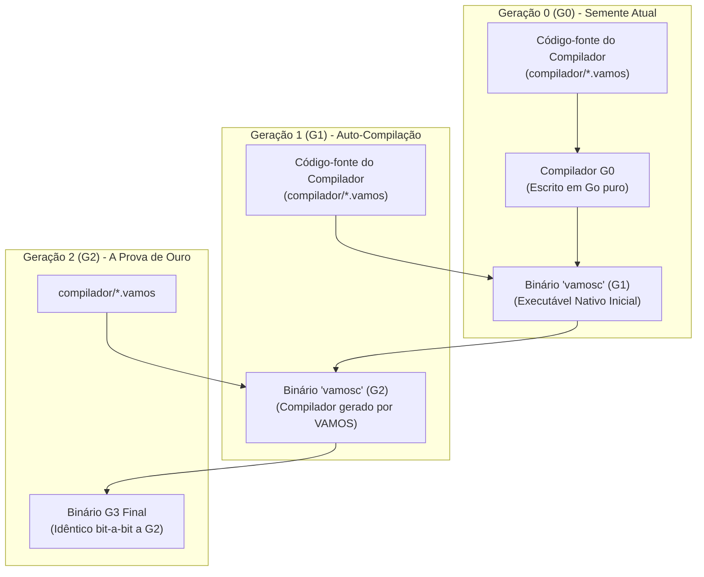

# 🚀 Roadmap de Auto-Hospedagem (Self-Hosting) e Bootstrapping de VAMOS-LANG

> **O marco definitivo de maturidade:** Tornar o VAMOS-LANG uma linguagem totalmente auto-hospedada, capaz de compilar seu próprio compilador e evoluir sem dependência de código-fonte em outra linguagem.

---

## 📌 Visão Geral e Conceito

**Bootstrapping** é o processo clássico na ciência da computação onde uma linguagem de programação atinge a autonomia completa. Grandes ecossistemas da computação (como Go 1.5, Rust, C e TypeScript) começaram implementados em uma linguagem hospedeira antes de serem reescritos em sua própria sintaxe.



---

## 🗺️ As 4 Etapas da Jornada de Bootstrapping

| Etapa | Meta | Descrição | Status |
| :---: | :--- | :--- | :---: |
| **1** | **Frontend Léxico e AST em VAMOS** | Implementar o tokenizador, nós da AST e analisador léxico 100% em arquivos `.vamos`. | ✅ **Concluído** |
| **2** | **Parser Sintático Descendente Recursivo** | Implementar o parser sintático e gerador visual de AST diretamente em VAMOS-LANG. | ✅ **Concluído** |
| **3** | **CLI Auto-Hospedada (`vamosc`) & Prova de Ouro** | CLI com `compilar`, `rodar`, `fmt` e ciclo completo de auto-compilação (G0 ➔ G1 ➔ G2 ➔ G3). | ✅ **Concluído** |
| **4** | **Independência Total e Emissão Direta** | Adicionar backend nativo para WebAssembly ou representação intermediária sem intermediários. | 🚀 **Próxima Etapa** |

---

## 📂 Arquitetura do Compilador Auto-Hospedado: [`compilador/`](file:///storage/www/projetos/VAMOSLANG/compilador)

A pasta [`compilador/`](file:///storage/www/projetos/VAMOSLANG/compilador) contém a implementação do compilador escrita na própria sintaxe VAMOS-LANG:

1. **[`compilador/token.vamos`](file:///storage/www/projetos/VAMOSLANG/compilador/token.vamos)**:
   - Tipos de tokens (`TokenPalavraChave`, `TokenIdentificador`, `TokenLiteral`, `TokenOperador`, `TokenDelimitador`, `TokenFimArquivo`).
   - Estrutura `Token` com linha, coluna e valor.
   - Tabelas de palavras-chave oficiais do VAMOS-LANG (incluindo `qualquer`, `comparavel`, `disparar`, `adiar`).
2. **[`compilador/lexico.vamos`](file:///storage/www/projetos/VAMOSLANG/compilador/lexico.vamos)**:
   - Motor de análise léxica `AnalisadorLexico` em VAMOS-LANG.
   - Suporte a operadores compostos (`:=`, `==`, `!=`, `<=`, `>=`, `&&`, `||`, `<-`, `++`, `--`, `~`, etc.).
   - Suporte a identificadores Unicode em PT-BR (acentos e cedilha).
   - Preservação de strings literais e comentários.
3. **[`compilador/ast.vamos`](file:///storage/www/projetos/VAMOSLANG/compilador/ast.vamos)**:
   - Estruturas de dados da Árvore Sintática Abstrata (AST) com nós hierárquicos e renderizador gráfico em árvore (`ImprimirArvore`).
4. **[`compilador/sintatico.vamos`](file:///storage/www/projetos/VAMOSLANG/compilador/sintatico.vamos)**:
   - Analisador sintático descendente recursivo (`AnalisadorSintatico`) em VAMOS-LANG.
   - Suporte completo a parsing de pacotes, importações, structs, interfaces, assinaturas de métodos com receptores, laços, condicionais e generics.
5. **[`compilador/formatador.vamos`](file:///storage/www/projetos/VAMOSLANG/compilador/formatador.vamos)**:
   - Formatador oficial de código escrito em VAMOS-LANG (`FormatarCodigo`), com indentação automática e preservação de raw strings.
6. **[`compilador/transpilador.vamos`](file:///storage/www/projetos/VAMOSLANG/compilador/transpilador.vamos)**:
   - Motor de emissão e transpilação em VAMOS-LANG com suporte a múltiplos arquivos de pacotes e stdlib.
7. **[`compilador/main.vamos`](file:///storage/www/projetos/VAMOSLANG/compilador/main.vamos)**:
   - Ponto de entrada CLI completo do compilador auto-hospedado (`vamosc`).
   - Comandos oficiais: `compilar`, `rodar`, `formatar`, `ast`, `tokens`, `transpilar` e `auto-teste`.

---

## 🛠️ Como Executar e Validar as Etapas 1, 2 e 3

```bash
# 1. Executar o Ciclo de Ouro completo de Bootstrapping (G0 -> G1 -> G2 -> G3):
make bootstrap

# 2. Compilar qualquer projeto ou exemplo diretamente com o 'vamosc':
./compilador/vamosc compilar exemplos/calculadora.vamos -o /tmp/calc
/tmp/calc

# 3. Executar código VAMOS diretamente pelo 'vamosc':
./compilador/vamosc rodar exemplos/ola_mundo.vamos

# 4. Formatar código usando o formatador em VAMOS:
./compilador/vamosc formatar exemplos/ola_mundo.vamos

# 5. Visualizar a AST de um arquivo:
./compilador/vamosc ast exemplos/estruturas_interfaces.vamos
```
# 1. Executar o compilador auto-hospedado diretamente pelo runtime VAMOS:
./vamos run compilador/main.vamos --tokens exemplos/ola_mundo.vamos

# 2. Compilar o executável nativo do compilador:
./vamos build -o compilador/vamosc compilador/main.vamos

# 3. Executar o binário compilado em VAMOS-LANG:
./compilador/vamosc --tokens exemplos/genericos.vamos
```
