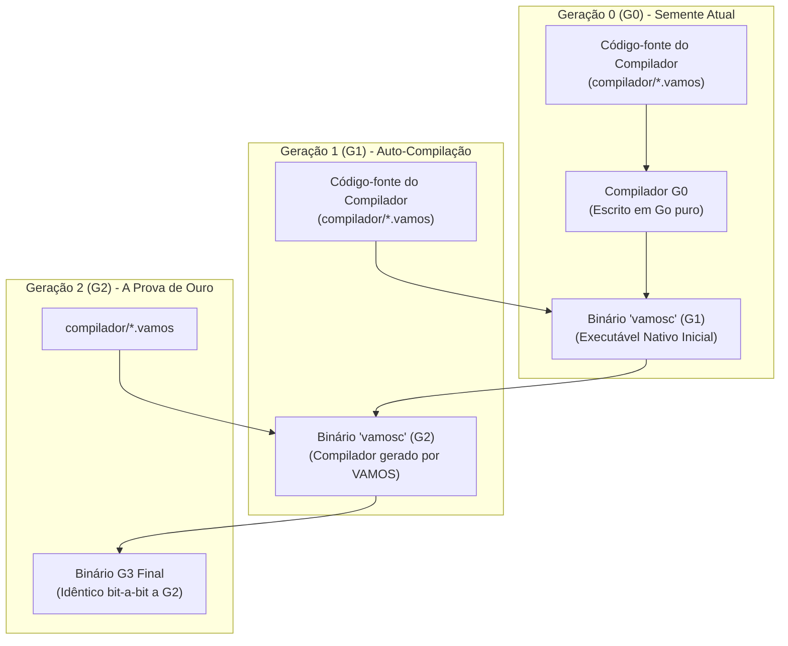

# 🚀 Roadmap de Auto-Hospedagem (Self-Hosting) e Bootstrapping de VAMOS-LANG

> **O marco definitivo de maturidade:** Tornar o VAMOS-LANG uma linguagem totalmente auto-hospedada, capaz de compilar seu próprio compilador e evoluir sem dependência de código-fonte em outra linguagem.

---

## 📌 Visão Geral e Conceito

**Bootstrapping** é o processo clássico na ciência da computação onde uma linguagem de programação atinge a autonomia completa. Grandes ecossistemas da computação (como Go 1.5, Rust, C e TypeScript) começaram implementados em uma linguagem hospedeira antes de serem reescritos em sua própria sintaxe.



---

## 🗺️ As 10 Etapas da Jornada de Bootstrapping

| Etapa | Meta | Descrição | Status |
| :---: | :--- | :--- | :---: |
| **1** | **Frontend Léxico e AST em VAMOS** | Implementar o tokenizador, nós da AST e analisador léxico 100% em arquivos `.vamos`. | ✅ **Concluído** |
| **2** | **Parser Sintático Descendente Recursivo** | Implementar o parser sintático e gerador visual de AST diretamente em VAMOS-LANG. | ✅ **Concluído** |
| **3** | **CLI Auto-Hospedada (`vamosc`) & Prova de Ouro** | CLI com `compilar`, `rodar`, `fmt` e ciclo completo de auto-compilação (G0 ➔ G1 ➔ G2 ➔ G3). | ✅ **Concluído** |
| **4** | **Emissão Direta e Máquina Virtual (VVM)** | Emissor de bytecode, execução na Máquina Virtual VVM, formato `.vamosb` serializável e persistente. | ✅ **Concluído** |
| **5** | **Emissão Nativa WebAssembly 1.0 (Wasm)** | Emissor direto de binários `.wasm` autônomos sem compiladores externos, com LEB128 e seção de exportação. | ✅ **Concluído** |
| **6** | **Análise Semântica e Verificação de Tipos** | Tabela de símbolos com escopos léxicos, validação de tipos, variáveis não declaradas e assinaturas de funções. | ✅ **Concluído** |
| **7** | **Backend C Nativo (C99) & Compilação via GCC** | Emissor de C99 nativo e geração de binários de máquina ELF sem dependência do compilador Go hospedeiro. | ✅ **Concluído** |
| **8** | **Mapas, Estruturas e Mutação na VVM** | `OpCriarMapa`, indexação flexível de chaves dinâmicas, instanciação e mutação de structs (`struct.campo = val`). | ✅ **Concluído** |
| **9** | **Biblioteca Padrão em VAMOS Puro** | Módulos canônicos (`pacotes/colecoes`, `pacotes/matematica_util`, `pacotes/texto_util`) em sintaxe VAMOS-LANG. | ✅ **Concluído** |
| **10** | **Otimizador de Bytecode (Constant Folding)** | Dobra estática de operações numéricas, peephole jump optimization e compactação de instruções. | ✅ **Concluído** |

---

## 📂 Arquitetura do Compilador Auto-Hospedado: [`compilador/`](file:///storage/www/projetos/VAMOSLANG/compilador)

A pasta [`compilador/`](file:///storage/www/projetos/VAMOSLANG/compilador) contém a implementação do compilador e máquina virtual escrita integralmente na própria sintaxe VAMOS-LANG:

1. **[`compilador/token.vamos`](file:///storage/www/projetos/VAMOSLANG/compilador/token.vamos)**:
   - Tipos de tokens (`TokenPalavraChave`, `TokenIdentificador`, `TokenLiteral`, `TokenOperador`, `TokenDelimitador`, `TokenFimArquivo`).
   - Estrutura `Token` com linha, coluna e valor.
   - Tabelas de palavras-chave oficiais do VAMOS-LANG (incluindo `qualquer`, `comparavel`, `disparar`, `adiar`).
2. **[`compilador/lexico.vamos`](file:///storage/www/projetos/VAMOSLANG/compilador/lexico.vamos)**:
   - Motor de análise léxica `AnalisadorLexico` em VAMOS-LANG.
   - Suporte a operadores compostos (`:=`, `==`, `!=`, `<=`, `>=`, `&&`, `||`, `<-`, `++`, `--`, `~`, etc.).
   - Suporte a identificadores Unicode em PT-BR (acentos e cedilha).
   - Preservação de strings literais e comentários.
3. **[`compilador/ast.vamos`](file:///storage/www/projetos/VAMOSLANG/compilador/ast.vamos)**:
   - Estruturas de dados da Árvore Sintática Abstrata (AST) com nós hierárquicos e renderizador gráfico em árvore (`ImprimirArvore`).
4. **[`compilador/sintatico.vamos`](file:///storage/www/projetos/VAMOSLANG/compilador/sintatico.vamos)**:
   - Analisador sintático descendente recursivo (`AnalisadorSintatico`) em VAMOS-LANG.
   - Suporte completo a parsing de pacotes, importações, structs, interfaces, assinaturas de métodos com receptores, laços, condicionais e generics.
5. **[`compilador/formatador.vamos`](file:///storage/www/projetos/VAMOSLANG/compilador/formatador.vamos)**:
   - Formatador oficial de código escrito em VAMOS-LANG (`FormatarCodigo`), com indentação automática e preservação de raw strings.
6. **[`compilador/bytecode.vamos`](file:///storage/www/projetos/VAMOSLANG/compilador/bytecode.vamos)**:
   - Especificação de opcodes (`OpConstante`, `OpObterGlobal`, `OpDefinirGlobal`, `OpObterLocal`, `OpDefinirLocal`, `OpSomar`, `OpSubtrair`, `OpMultiplicar`, `OpDividir`, `OpIgual`, `OpSalto`, `OpSaltoSeFalso`, `OpImprimirLinha`, `OpChamar`, `OpRetornar`, `OpTamanho`, `OpCriarLista`, `OpAnexar`, `OpObterIndice`, `OpDefinirIndice`, `OpCriarMapa`, `OpParar`).
   - Tabela de constantes, pool de identificadores, tabela de funções e disassembler legível em Assembly VVM.
   - Serialização e desserialização binária/textual padronizada para arquivos de bytecode `.vamosb`.
7. **[`compilador/vm.vamos`](file:///storage/www/projetos/VAMOSLANG/compilador/vm.vamos)**:
   - Máquina Virtual VVM baseada em pilha com ponteiro de instruções (`ip`), call stack (`QuadroChamada`), escopo local isolado, recursão, suporte completo a listas dinâmicas (`[]tipo`), mapas chave-valor (`mapa[k]v`) e estruturas com acesso e mutação de campos (`u.Nome`, `u.Idade = 29`).
8. **[`compilador/emissor.vamos`](file:///storage/www/projetos/VAMOSLANG/compilador/emissor.vamos)**:
   - Emissor direto de bytecode a partir da AST: compila funções com prólogo/epílogo, avaliação de expressões com precedência e parênteses (`dividirForaParenteses`), condicionais, laços `para`, literais compostos (`[]tipo{...}`, `mapa[k]v{...}`, `Struct{...}`), indexação (`lista[i]`, `mapa[k]`) e mutação de campos (`obj.campo = val`).
9. **[`compilador/wasm.vamos`](file:///storage/www/projetos/VAMOSLANG/compilador/wasm.vamos)**:
   - Emissor nativo de WebAssembly 1.0 (MVP standard) em VAMOS-LANG puro.
   - Codificação de inteiros assinados e não-assinados no padrão LEB128 de 7 bits (`CodificarLEB128U`, `CodificarLEB128S`).
   - Seções canônicas de módulo Wasm: Type (1), Function (3), Export (7) e Code (10).
   - Opcodes de pilha: aritmética i32 (`add`, `sub`, `mul`, `div_s`), comparações relacionais (`eq`, `ne`, `lt_s`, `gt_s`, `le_s`, `ge_s`), fluxo condicional (`if`, `else`, `end`), chamadas diretas com recursão (`call`) e variáveis locais (`local.get`, `local.set`).
   - Gera módulos `.wasm` ultra-compactos (menos de 300 bytes) sem dependências externas.
10. **[`compilador/semantico.vamos`](file:///storage/www/projetos/VAMOSLANG/compilador/semantico.vamos)**:
    - Analisador semântico e verificador de tipos em tempo de compilação em VAMOS-LANG.
    - Tabela de símbolos com encadeamento de escopos léxicos (`Escopo`).
    - Validação de identificadores não declarados, variáveis duplicadas, verificação de tipos e contagem de argumentos em chamadas de função.
11. **[`compilador/emissor_c.vamos`](file:///storage/www/projetos/VAMOSLANG/compilador/emissor_c.vamos)**:
    - Backend C nativo (C99 standard) para compilação direta via GCC, Clang e TinyCC.
    - Tradução direta de AST para código C puro: mapeamento de tipos primitivos (`int64_t`, `double`, `const char*`, `bool`), estruturas (`typedef struct`), funções, laços `for/while`, condicionais e E/S formatada com `printf`.
    - Produz binários ELF nativos ultra-leves (~16 KB) totalmente desvinculados do toolchain Go.
12. **[`compilador/transpilador.vamos`](file:///storage/www/projetos/VAMOSLANG/compilador/transpilador.vamos)**:
    - Motor de emissão Go em VAMOS-LANG para geração de binários nativos de máquina.
13. **[`compilador/main.vamos`](file:///storage/www/projetos/VAMOSLANG/compilador/main.vamos)**:
    - Ponto de entrada CLI completo do compilador auto-hospedado (`vamosc`).
    - Comandos oficiais: `compilar`, `compilar-c`, `c`, `rodar`, `vm`, `bytecode`, `wasm`, `checar`, `formatar`, `ast`, `tokens`, `transpilar` e `auto-teste`.
14. **[`pacotes/colecoes/colecoes.vamos`](file:///storage/www/projetos/VAMOSLANG/pacotes/colecoes/colecoes.vamos)**:
    - Estruturas de dados genéricas em VAMOS-LANG puro: `Pilha[T qualquer]`, `Fila[T qualquer]` e `Conjunto[T comparavel]`.
    - Métodos padrão: `Empilhar`, `Desempilhar`, `Topo`, `Enfileirar`, `Desenfileirar`, `Frente`, `Inserir`, `Add`, `Contem`, `Remover`, `ParaLista`.
15. **[`pacotes/matematica_util/matematica_util.vamos`](file:///storage/www/projetos/VAMOSLANG/pacotes/matematica_util/matematica_util.vamos)**:
    - Biblioteca matemática autônoma: `Absoluto`, `Maximo`, `Minimo`, `Potencia`, `Fatorial`, `Fibonacci`, `MDC`, `MMC`, `EhPrimo`, `Clampar`.
16. **[`pacotes/texto_util/texto_util.vamos`](file:///storage/www/projetos/VAMOSLANG/pacotes/texto_util/texto_util.vamos)**:
    - Manipulação de strings em português: `Dividir`, `Juntar`, `Contem`, `ComecaCom`, `TerminaCom`, `ParaMaiusculas`, `ParaMinusculas`, `Aparar`, `Substituir`, `Repetir`, `IndiceDe`, `Inverter`.
17. **[`compilador/otimizador.vamos`](file:///storage/www/projetos/VAMOSLANG/compilador/otimizador.vamos)**:
    - Otimizador estático de bytecode VVM (`OtimizarBytecode`):
    - **Constant Folding**: Pré-computação em tempo de compilação de operações aritméticas binárias (`+`, `-`, `*`, `/`) entre literais inteiros.
    - **Peephole Optimization**: Eliminação de saltos redundantes para o endereço sequencial (`i+1`).
    - **Compactação e Remapeamento**: Reordenação atômica de endereços de salto e tabela de funções.

---

## 🛠️ Como Executar e Validar

```bash
# 1. Executar o Ciclo de Ouro completo de Bootstrapping (G0 -> G1 -> G2 -> G3 + Wasm + C/GCC):
make bootstrap

# 2. Compilar binário nativo executável diretamente via GCC (sem Go):
./vamos compilar-c exemplos/c_nativo.vamos -o /tmp/c_app
/tmp/c_app

# 3. Gerar código-fonte C99 nativo a partir do código .vamos:
./vamos c exemplos/c_nativo.vamos -o /tmp/c_app.c

# 4. Executar verificação semântica estática e de tipos:
./vamosc checar exemplos/ola_mundo.vamos

# 5. Compilar diretamente para WebAssembly 1.0 nativo (.wasm):
./vamos wasm exemplos/wasm_modulo.vamos -o modulo.wasm
# ou via compilador auto-hospedado:
./compilador/vamosc wasm exemplos/wasm_modulo.vamos -o modulo.wasm

# 6. Executar código diretamente na Máquina Virtual VVM:
./compilador/vamosc vm exemplos/maquina_virtual.vamos

# 7. Gerar e salvar arquivo de Bytecode VVM (.vamosb):
./compilador/vamosc bytecode exemplos/maquina_virtual.vamos -o app.vamosb

# 8. Executar arquivo de Bytecode (.vamosb) diretamente na VM:
./compilador/vamosc vm app.vamosb

# 9. Desassemblar bytecode de um arquivo .vamos ou .vamosb:
./compilador/vamosc bytecode app.vamosb

# 10. Compilar executável binário de máquina com o 'vamosc':
./compilador/vamosc compilar exemplos/calculadora.vamos -o /tmp/calc
/tmp/calc

# 11. Formatar código usando o formatador em VAMOS:
./compilador/vamosc formatar exemplos/ola_mundo.vamos

# 12. Visualizar a Árvore Sintática Abstrata (AST):
./compilador/vamosc ast exemplos/estruturas_interfaces.vamos
```
