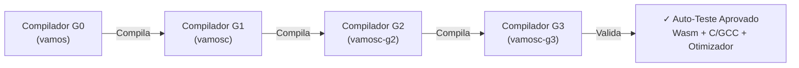

# 🚀 Compilador Auto-Hospedado VAMOS-LANG (`vamosc`)

> **O compilador oficial de VAMOS-LANG escrito 100% na própria linguagem VAMOS-LANG.**

Este diretório contém a base de código do compilador auto-hospedado (`vamosc`), da Máquina Virtual baseada em pilha (VVM), dos emissores WebAssembly (Wasm 1.0) e C (C99/GCC), e do otimizador estático de bytecode.

---

## 📂 Arquitetura e Módulos do Compilador

| Arquivo | Função / Responsabilidade |
| :--- | :--- |
| **[`token.vamos`](file:///storage/www/projetos/VAMOSLANG/compilador/token.vamos)** | Definição de tokens, estruturas léxicas, operadores compostos e palavras-chave reservadas em PT-BR. |
| **[`lexico.vamos`](file:///storage/www/projetos/VAMOSLANG/compilador/lexico.vamos)** | Analisador léxico (`AnalisadorLexico`) com suporte total a identificadores Unicode PT-BR, raw strings e comentários. |
| **[`ast.vamos`](file:///storage/www/projetos/VAMOSLANG/compilador/ast.vamos)** | Tipos de nós da Árvore Sintática Abstrata (AST) e renderizador visual hierárquico em árvore ASCII. |
| **[`sintatico.vamos`](file:///storage/www/projetos/VAMOSLANG/compilador/sintatico.vamos)** | Analisador sintático descendente recursivo (`AnalisadorSintatico`), suporte a pacotes, structs, interfaces e generics. |
| **[`formatador.vamos`](file:///storage/www/projetos/VAMOSLANG/compilador/formatador.vamos)** | Formatador automático de código-fonte (`FormatarCodigo`) com alinhamento e indentação padrão. |
| **[`semantico.vamos`](file:///storage/www/projetos/VAMOSLANG/compilador/semantico.vamos)** | Verificador semântico e de tipos: escopos léxicos (`Escopo`), tabela de símbolos e checagem de variáveis duplicadas/não declaradas. |
| **[`bytecode.vamos`](file:///storage/www/projetos/VAMOSLANG/compilador/bytecode.vamos)** | Especificação dos 30 Opcodes VVM, tabelas de constantes, identificadores e formato binário/serializável `.vamosb`. |
| **[`emissor.vamos`](file:///storage/www/projetos/VAMOSLANG/compilador/emissor.vamos)** | Emissor direto de bytecode a partir da AST: prólogo/epílogo de funções, laços, condicionais, listas e mapas. |
| **[`vm.vamos`](file:///storage/www/projetos/VAMOSLANG/compilador/vm.vamos)** | Máquina Virtual VVM: call stack, escopos locais, recursão, aritmética, mapas dinâmicos e structs. |
| **[`otimizador.vamos`](file:///storage/www/projetos/VAMOSLANG/compilador/otimizador.vamos)** | Otimizador de bytecode: Constant Folding (dobra de constantes), eliminação de saltos redundantes e remapeamento de endereços. |
| **[`wasm.vamos`](file:///storage/www/projetos/VAMOSLANG/compilador/wasm.vamos)** | Emissor nativo de WebAssembly 1.0 (MVP): codificação LEB128, seções Wasm Type, Function, Export e Code. |
| **[`emissor_c.vamos`](file:///storage/www/projetos/VAMOSLANG/compilador/emissor_c.vamos)** | Backend C nativo (C99): tradução de AST para C puro, compilável via GCC/Clang em binários nativos de 16 KB. |
| **[`transpilador.vamos`](file:///storage/www/projetos/VAMOSLANG/compilador/transpilador.vamos)** | Emissor Go nativo a partir do fluxo de tokens para compilação rápida de máquina. |
| **[`main.vamos`](file:///storage/www/projetos/VAMOSLANG/compilador/main.vamos)** | Ponto de entrada CLI completo (`vamosc`) e suíte de auto-teste de bootstrapping (Etapas 1 a 10). |

---

## 🛠️ Comandos da CLI Auto-Hospedada (`vamosc`)

```bash
# Compilar binário executável nativo de máquina
./compilador/vamosc compilar arquivo.vamos -o app

# Compilar binário ultra-leve via GCC (C99 nativo, sem runtime Go)
./compilador/vamosc compilar-c arquivo.vamos -o app_c

# Gerar código-fonte C99 nativo
./compilador/vamosc c arquivo.vamos -o app.c

# Compilar para WebAssembly 1.0 (.wasm) autônomo
./compilador/vamosc wasm modulo.vamos -o modulo.wasm

# Gerar e desassemblar Bytecode VVM (.vamosb)
./compilador/vamosc bytecode arquivo.vamos -o app.vamosb

# Otimizar Bytecode aplicando Constant Folding e eliminação de código inútil
./compilador/vamosc otimizar arquivo.vamos -o app_otimizado.vamosb

# Executar arquivo diretamente na Máquina Virtual VVM
./compilador/vamosc vm app.vamosb

# Verificação semântica estática e de tipos
./compilador/vamosc checar arquivo.vamos

# Formatar código-fonte padronizado
./compilador/vamosc fmt arquivo.vamos

# Visualizar a Árvore Sintática Abstrata (AST)
./compilador/vamosc ast arquivo.vamos

# Executar a suíte interna de auto-teste de integridade
./compilador/vamosc --auto-teste
```

---

## 🔄 O Ciclo de Ouro do Bootstrapping

O compilador `vamosc` demonstra a auto-suficiência através da cadeia sucessiva de compilação:



Para reproduzir a prova completa de auto-hospedagem:
```bash
make bootstrap
```
